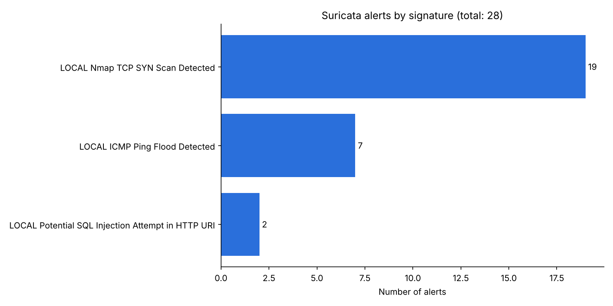

# CodeAlpha_NetworkIDS

Network Intrusion Detection System using **Suricata** on Kali Linux, with custom rules, an automated response script and alert visualization.

## Files

| File | Purpose |
|---|---|
| `rules/local.rules` | 3 custom Suricata rules (SYN scan, ICMP flood, SQL injection) |
| `scripts/auto_block.py` | Tails `eve.json`, blocks attacker IPs via `iptables` (with safelist) |
| `scripts/visualize_alerts.py` | Builds `alerts_summary.png` (alerts per signature) with pandas + matplotlib |
| `logs/sample_fast.log` | Sample `fast.log` output |
| `logs/sample_eve.json` | Sample `eve.json` events used to demo the chart |
| `screenshots/alerts_summary.png` | Example chart |

> **Note:** the files in `logs/` and `alerts_summary.png` are illustrative sample data in the real Suricata format. Replace them with output from your own run (see "Run it live").

## 1. Install and configure

```bash
sudo apt update && sudo apt install suricata -y
ip a    # note your active interface (eth0 / wlan0)
```

Edit `/etc/suricata/suricata.yaml`:
- `vars: address-groups: HOME_NET:` -> your local subnet, e.g. `"[192.168.56.0/24]"`
- `af-packet:` -> `- interface: <your interface>`
- `rule-files:` -> add `- local.rules`

Copy the rules: `sudo cp rules/local.rules /etc/suricata/rules/local.rules`

## 2. Detection rules

| SID | Detects | Logic |
|---|---|---|
| 1000001 | Nmap TCP SYN scan | SYN-only packets, 15+ from one source in 5 s |
| 1000002 | ICMP ping flood | echo requests, 10+ from one source in 3 s |
| 1000003 | SQL injection | `UNION` and `SELECT` (case-insensitive) in the HTTP URI |

## 3. Validate and monitor

```bash
sudo suricata -T -c /etc/suricata/suricata.yaml -v
sudo systemctl restart suricata
tail -f /var/log/suricata/fast.log
```

Trigger alerts from another host:
```bash
nmap -sS <target_ip>
ping -c 15 -i 0.2 <target_ip>   # controlled burst (avoid ping -f)
curl "http://<target_ip>/?id=1%20UNION%20SELECT%201,2"
```

## 4. Automated response

```bash
sudo python3 scripts/auto_block.py --dry-run          # preview only
sudo python3 scripts/auto_block.py --max-severity 2   # actually block
```

- Reads new events from `eve.json`; acts on `alert` events with severity <= `--max-severity` (Suricata: 1 = highest).
- Runs `iptables -A INPUT -s <src_ip> -j DROP` (no shell, IP validated, no duplicate rules).
- Never blocks localhost, this machine's own IPs or the default gateway; add more with `--safelist`.
- Rule severities follow their classtype: SQLi = 1, ping flood = 2, port scan = 3. Use `--max-severity 3` to also block scanners.
- Undo a block: `sudo iptables -D INPUT -s <ip> -j DROP`

## 5. Visualize

```bash
python3 scripts/visualize_alerts.py /var/log/suricata/eve.json -o screenshots/alerts_summary.png
```



## Safety

Install deps with `pip install -r requirements.txt`. Only test against machines you own or are authorized to scan. Test the blocker with `--dry-run` first, so you can't lock yourself out of a remote session.


Created by [MD Raisul Fahad](https://github.com/raisul06) ·
